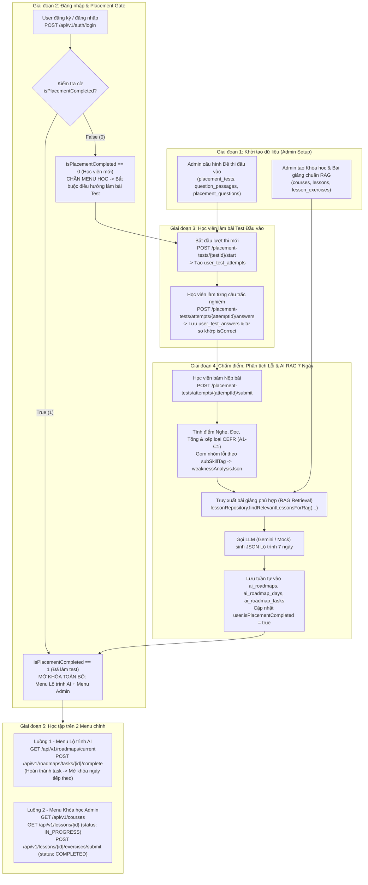
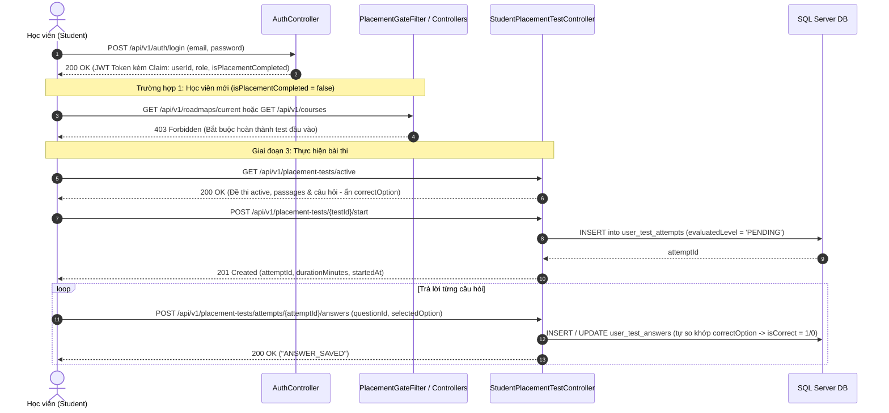
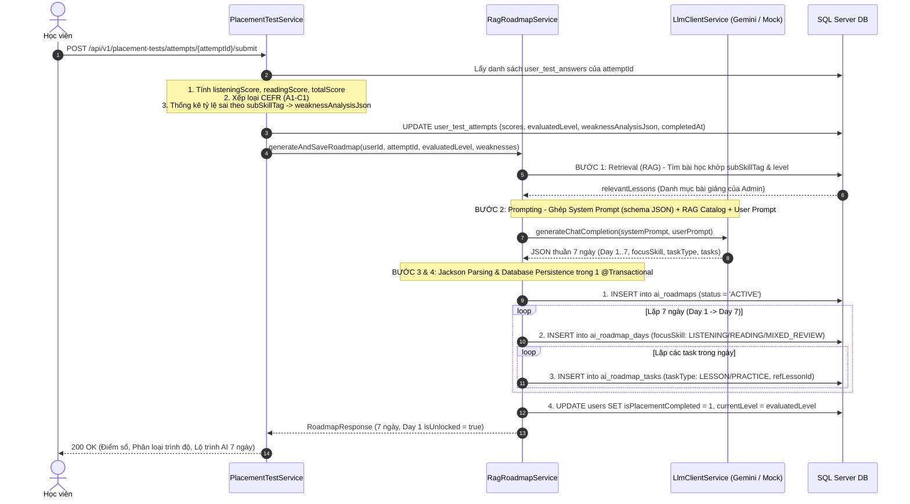

# TÀI LIỆU KIẾN TRÚC & ĐẶC TẢ TOÀN BỘ LUỒNG NGHIỆP VỤ HỆ THỐNG
## SMART ENGLISH LEARNING SYSTEM WITH LLM & RAG (5 GIAI ĐOẠN)

Tài liệu này hệ thống hóa toàn bộ luồng hoạt động xuyên suốt 5 giai đoạn cốt lõi của dự án **Smart English Learning**, từ khâu khởi tạo dữ liệu của Admin, kiểm soát phân quyền JWT & cổng thi đầu vào (Placement Gate), làm bài test và kích hoạt AI RAG sinh lộ trình 7 ngày, cho đến 2 menu học tập độc lập của học viên.

---

## 1. SƠ ĐỒ TỔNG THỂ 5 GIAI ĐOẠN (SYSTEM ARCHITECTURE WORKFLOW)

---

## 2. CHI TIẾT CÁC GIAI ĐOẠN NGHIỆP VỤ & SƠ ĐỒ TUẦN TỰ (SEQUENCE DIAGRAM)

### GIAI ĐOẠN 1: KHỞI TẠO DỮ LIỆU NỀN TẢNG (ADMIN SETUP)
Trước khi học viên sử dụng hệ thống, Admin chuẩn bị dữ liệu qua 2 nhánh bảng:
1. **Đề kiểm tra đầu vào (Placement Test Engine):**
   - Bảng `placement_tests`: Quản lý thông tin đề thi (`title`, `durationMinutes`, `totalQuestions`).
   - Bảng `question_passages`: Đoạn văn đọc hiểu hoặc audio nghe hiểu (`skillType`: `'LISTENING'` hoặc `'READING'`).
   - Bảng `placement_questions`: Câu hỏi trắc nghiệm A/B/C/D gắn nhãn kỹ năng chi tiết `subSkillTag` (ví dụ: `LISTENING_DETAIL`, `READING_VOCAB`).
2. **Kho bài giảng chuẩn hóa hỗ trợ RAG (Course & Lesson Catalog):**
   - Bảng `courses`: Khóa học theo trình độ CEFR (`targetLevel`: A1, A2, B1, B2, C1).
   - Bảng `lessons`: Bài giảng gắn nhãn `subSkillTag` đồng bộ 100% với nhãn của đề thi test để RAG tìm kiếm chính xác bài học bổ trợ đúng điểm yếu của học viên.
   - Bảng `lesson_exercises`: Bộ câu hỏi luyện tập ôn bài sau bài học.

---

### GIAI ĐOẠN 2 & 3: ĐĂNG NHẬP, PLACEMENT GATE & HỌC VIÊN LÀM BÀI TEST

---

### GIAI ĐOẠN 4: NỘP BÀI -> PHÂN TÍCH ĐIỂM YẾU & RAG AI SINH LỘ TRÌNH 7 NGÀY

---

### GIAI ĐOẠN 5: HỌC VIÊN HỌC TẬP TRÊN 2 MENU CHÍNH

#### LUỒNG 1: MENU HỌC THEO LỘ TRÌNH CÁ NHÂN HÓA AI (7 DAYS)
1. **Lấy lộ trình:** Học viên gọi `GET /api/v1/roadmaps/current` -> Backend truy vấn `ai_roadmaps` (status `'ACTIVE'`), trả về 7 ngày. Ban đầu chỉ **Ngày 1** có cờ `isUnlocked = true`, các ngày 2–7 bị khóa (`isUnlocked = false`).
2. **Làm nhiệm vụ (Tasks):** Học viên hoàn thành từng task và gọi `POST /api/v1/roadmaps/tasks/{taskId}/complete` kèm `userScore`.
3. **Mở khóa ngày tiếp theo (Auto-Unlock):**
   - Khi tất cả task trong Ngày $N$ hoàn tất (`isCompleted = true`), bản ghi `ai_roadmap_days` của Ngày $N$ đổi thành `isCompleted = true`.
   - Hệ thống tự động kích hoạt Ngày $N+1$: đổi `isUnlocked = true` để học viên tiếp tục học.

#### LUỒNG 2: MENU HỌC THEO BÀI GIẢNG ADMIN CẤU HÌNH (COURSES & LESSONS)
1. **Xem khóa học:** `GET /api/v1/courses` (lọc theo `targetLevel=B1`).
2. **Mở bài học (Lesson):** `GET /api/v1/lessons/{lessonId}`.
   - Hệ thống tự động tạo hoặc cập nhật bản ghi trong bảng `user_lesson_progress` với `status = 'IN_PROGRESS'` và `lastAccessedAt = NOW()`.
3. **Lấy câu hỏi ôn tập:** `GET /api/v1/lessons/{lessonId}/exercises` (đáp án đúng `correctOption` được ẩn).
4. **Nộp bài tập:** `POST /api/v1/lessons/{lessonId}/exercises/submit`.
   - Hệ thống tự động so khớp đáp án, tính điểm `practiceScore` (thang 100), cập nhật trạng thái bài học thành `status = 'COMPLETED'` và `completedAt = NOW()`.
5. **Kiểm tra tiến độ:** `GET /api/v1/lessons/{lessonId}/progress`.

---

## 3. BẢNG TỔNG HỢP ENDPOINTS TOÀN HỆ THỐNG

| Giai đoạn | HTTP Method | Endpoint | Quyền hạn | Mô tả nghiệp vụ |
|:---:|:---:|:---|:---:|:---|
| **1** | POST | `/api/v1/admin/placement-tests` | `ROLE_ADMIN` | Admin tạo đề thi đầu vào |
| **1** | POST | `/api/v1/admin/placement-tests/{testId}/passages` | `ROLE_ADMIN` | Admin thêm đoạn văn đọc/audio nghe |
| **1** | POST | `/api/v1/admin/placement-tests/passages/{passageId}/questions` | `ROLE_ADMIN` | Admin thêm câu hỏi trắc nghiệm kèm `subSkillTag` |
| **1** | POST | `/api/v1/admin/courses` | `ROLE_ADMIN` | Admin tạo khóa học (A1-C1) |
| **1** | POST | `/api/v1/admin/courses/{courseId}/lessons` | `ROLE_ADMIN` | Admin soạn bài giảng chuẩn hóa RAG |
| **1** | POST | `/api/v1/admin/courses/lessons/{lessonId}/exercises` | `ROLE_ADMIN` | Admin thêm bài tập trắc nghiệm cho bài giảng |
| **2** | POST | `/api/v1/auth/register` | Public | Đăng ký tài khoản học viên mới (`isPlacementCompleted=0`) |
| **2** | POST | `/api/v1/auth/login` | Public | Đăng nhập lấy JWT Token (chứa claim `isPlacementCompleted`) |
| **2** | GET | `/api/v1/placement-tests/status` | `STUDENT, ADMIN` | Kiểm tra trạng thái điều kiện vào học |
| **3** | GET | `/api/v1/placement-tests/active` | `STUDENT, ADMIN` | Lấy nội dung đề thi (giấu đáp án đúng) |
| **3** | POST | `/api/v1/placement-tests/{testId}/start` | `STUDENT, ADMIN` | Bắt đầu lượt thi -> sinh `user_test_attempts` |
| **3** | POST | `/api/v1/placement-tests/attempts/{attemptId}/answers` | `STUDENT, ADMIN` | Lưu lựa chọn của học viên vào `user_test_answers` |
| **3** | POST | `/api/v1/placement-tests/attempts/{attemptId}/batch-answers` | `STUDENT, ADMIN` | Lưu hàng loạt đáp án trước khi nộp |
| **4** | POST | `/api/v1/placement-tests/attempts/{attemptId}/submit` | `STUDENT, ADMIN` | Chấm điểm, phân tích điểm yếu & RAG AI sinh lộ trình 7 ngày |
| **5.1** | GET | `/api/v1/roadmaps/current` | `ROLE_STUDENT` | Lấy lộ trình 7 ngày AI (Chặn nếu chưa làm test) |
| **5.1** | POST | `/api/v1/roadmaps/tasks/{taskId}/complete` | `ROLE_STUDENT` | Hoàn thành task, chấm điểm, tự mở khóa ngày tiếp theo |
| **5.2** | GET | `/api/v1/courses` | `STUDENT, ADMIN` | Duyệt danh sách khóa học tiêu chuẩn |
| **5.2** | GET | `/api/v1/lessons/{lessonId}` | `STUDENT, ADMIN` | Mở bài học -> Tự động ghi nhận `IN_PROGRESS` |
| **5.2** | GET | `/api/v1/lessons/{lessonId}/exercises` | `STUDENT, ADMIN` | Lấy câu hỏi luyện tập của bài học |
| **5.2** | POST | `/api/v1/lessons/{lessonId}/exercises/submit` | `STUDENT, ADMIN` | Nộp bài tập -> Lưu `practiceScore` & đổi `COMPLETED` |
| **5.2** | GET | `/api/v1/lessons/{lessonId}/progress` | `STUDENT, ADMIN` | Xem tiến độ học tập bài giảng |

---

## 4. QUY TẮC RÀNG BUỘC DATABASE CỐT LÕI (CHECK CONSTRAINTS)
Khi viết mã nguồn và test, bắt buộc tuân thủ 100% các giá trị sau để không vi phạm SQL Server CHECK Constraints:

1. `ai_roadmap_days.focusSkill`: `CHECK (focusSkill IN ('LISTENING', 'READING', 'MIXED_REVIEW'))`
2. `ai_roadmap_days.dayNumber`: `CHECK (dayNumber BETWEEN 1 AND 7)`
3. `ai_roadmap_tasks.taskType`: `CHECK (taskType IN ('LESSON', 'PRACTICE'))`
4. `ai_roadmaps.status`: `CHECK (status IN ('ACTIVE', 'COMPLETED', 'ARCHIVED'))`
5. `user_lesson_progress.status`: `CHECK (status IN ('IN_PROGRESS', 'COMPLETED'))`
6. `lesson_exercises.correctOption` & `user_test_answers.selectedOption`: `CHECK (... IN ('A', 'B', 'C', 'D'))`

